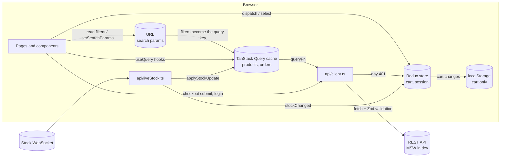

# Architecture

The Bug Bazaar is a single-page React app. It talks to one REST API (described in `docs/api-contract.md`) and one WebSocket for live stock. In development and on GitHub Pages, both are served by MSW inside the browser, so the app runs without a backend.

## Folder structure

```
src/
  main.tsx        Starts the mock API (if enabled), creates the store, query client and router, renders
  api/            The only code that talks to the network
    contract.ts     Zod schemas and types for every request and response
    client.ts       The only file that calls fetch: token, Idempotency-Key, validation, ApiClientError
    liveStock.ts    WebSocket feed with reconnect and backoff
    requestState.ts RequestState union (idle | loading | error | success)
    errorCopy.ts    ApiClientError kind → friendly text
  app/            App shell: routes, store, query client, header, typed Redux hooks
  features/       One folder per area of the store
    products/       Grid, card, details page, filters, product queries
    cart/           cartSlice, cart persistence, cart and checkout pages
    auth/           sessionSlice, login page, RequireAuth, account page
    orders/         Order confirmation page that polls the order status
    stock/          useLiveStock and applyStockUpdate
  components/     Shared UI: StatusView, error boundary and fallbacks, NotFoundPage, BackToTop
  hooks/          Generic hooks: useDebouncedValue, useWindowEvent, useInView
  lib/            Plain helpers: money, form errors, toRequestState adapter, logger
  mocks/          MSW handlers, in-memory database, 5,000-product seed, error controls, live stock socket
  dev/            Mock controls panel (only shown when the mock API is on)
  theme/, styles/ antd theme tokens and the matching SCSS variables
  test/           Test setup and helpers (renderApp, session, captureError)
```

Code is grouped by feature, not by file type. Everything for the cart sits in `features/cart/`. Shared folders (`components/`, `hooks/`, `lib/`) hold only code used by more than one feature.

## Data flow



A typical read, browsing the grid:

1. `useProductFilters` reads search, category, sort and in-stock from the URL.
2. `useInfiniteProducts(filters)` uses those filters as the query key. On a cache miss it calls `getProducts` in `client.ts`.
3. `client.ts` sends the request, validates the response with Zod, and either returns typed data or throws an `ApiClientError` with a `kind`.
4. `toRequestState` turns the query result into a `RequestState`, and `StatusView` renders loading, empty, error or the grid.

A typical write, checkout:

1. `CheckoutPage` dispatches `checkoutStarted`, which stores one `Idempotency-Key` in the cart (or keeps the existing one).
2. On submit it calls `createOrder(items, key)` directly from the event handler.
3. On success it invalidates the product queries (so stock refetches), clears the cart and goes to `/orders/:id`, which polls with `useOrder` until the status is `confirmed` or `failed`.
4. On a 409 it names the product that ran out and lowers the cart to the real stock. On a lost response the user retries with the same key, so the server returns the first order instead of creating a second one.

## Where state lives

| State                                      | Where                                                         | Why there                                                                                                                                                    |
| ------------------------------------------ | ------------------------------------------------------------- | ------------------------------------------------------------------------------------------------------------------------------------------------------------ |
| Products, product details, orders          | TanStack Query cache (`productQueries.ts`, `orderQueries.ts`) | It's a copy of server data. It needs caching, deduping, refetching, cancelling and polling, which the cache does and Redux would need hand-written code for. |
| Live stock numbers                         | Written into the same query cache (`applyStockUpdate.ts`)     | Stock is server data, so updates patch the cached products. Every page showing that product updates at once.                                                 |
| Cart lines and checkout key                | Redux `cart` slice, saved to `localStorage`                   | It belongs to the user, not the server, and must survive a reload. Many components read it (header badge, cart, checkout, add-to-cart).                      |
| Session (user, expired flag)               | Redux `session` slice                                         | Read by the header, `RequireAuth` and the account page. A 401 anywhere clears it through one listener.                                                       |
| Auth token                                 | A variable inside `client.ts` (memory only)                   | Nothing else needs to read it, and keeping it out of storage means an XSS bug can't read it later. See `docs/auth.md`.                                       |
| Filters (search, category, sort, in stock) | The URL                                                       | A link can be shared or bookmarked, refresh keeps the view, and Back undoes a filter.                                                                        |
| Form input, open panels, debounced text    | Component state                                               | Only one component cares, and it's thrown away when the component goes.                                                                                      |

## One choice, defended: server state in TanStack Query, not in Redux

The brief asks for Redux Toolkit, so a natural question is why products aren't in Redux too.

- **What it is.** Products and orders are a cache of the server, not state the app owns. The real questions for them are: is this copy fresh, is a request already running, should this request be cancelled because the user moved on. TanStack Query answers each of those by default. In Redux I would have written loading flags, abort logic and a staleness check by hand for every endpoint.
- **What it fixed in practice.** The search race (D2-6) is handled because the query key is the filters: a late reply for an old search is stored under the old key and never shown. Switching products quickly cancels the old request through the `AbortSignal` passed to `client.ts`. Going back to the grid or opening a product the grid already loaded shows it instantly (`staleTime` 60 s, `initialData` from the list).
- **What it costs.** Two state tools instead of one, so a new developer has to learn where each kind of state goes. The table above is the rule. Live stock touches both: it patches the query cache and also dispatches `stockChanged` so the cart can't hold more than the new stock.
- **Alternative considered.** RTK Query keeps everything in Redux and would also work. Keeping server data out of Redux makes the server/client split visible in the code: if it's in Redux, the app owns it (see `docs/decisions.md`, "Server state: TanStack Query").

## Design patterns

### 1. Adapter: one shape for errors and request status

- **Where:** `api/client.ts` turns every failure (HTTP status, network error, a body that fails Zod) into one `ApiClientError` with a `kind`. `lib/toRequestState.ts` turns a TanStack Query result into our own `RequestState` union. `api/errorCopy.ts` turns a `kind` into friendly text.
- **Why:** the rest of the app depends on our shapes, not on `fetch` or TanStack Query. `StatusView` only knows `RequestState`; pages only switch on `error.kind`. If we swapped the data library or the backend's error format, only the adapter would change. It also enforces two rules from the brief in one place: payloads are validated at the boundary, and raw server messages never reach the screen.

### 2. Custom hooks: logic separate from markup

- **Where:** `useProductFilters` (filters ↔ URL), `useInfiniteProducts` and `useProduct` (server data), `useLiveStock` (socket lifetime), `useDebouncedValue`, `useWindowEvent` and `useInView` (generic browser behavior), `useLogout`.
- **Why:** each hook owns one job, including its cleanup. For example, `useLiveStock` opens the feed in an effect and stops it in the cleanup, so no component has to remember to close a socket. The generic hooks are reused (`useDebouncedValue` for search, `useWindowEvent` for Back to Top and arrow keys on the details page) and are tested on their own in `hooks.test.ts`.

### 3. Container and presentational components

- **Where:** `ProductListPage` is the container: it reads filters with `useProductFilters` and data with `useInfiniteProducts`, and decides which state to show. `ProductGrid` and `ProductCard` are presentational: they take `products` / `product` as props and never fetch or read the URL. `StatusView` is presentational too: it gets a `RequestState` and renders it.
- **Why:** the presentational parts are easy to test and to reuse. `ProductGrid.perf.test.tsx` renders the grid with plain data and counts card renders, with no API involved. It also made the performance fix simple: because `ProductCard` only depends on its `product` prop, wrapping it in `React.memo` was enough to stop 49 of 50 cards re-rendering on a stock update.
