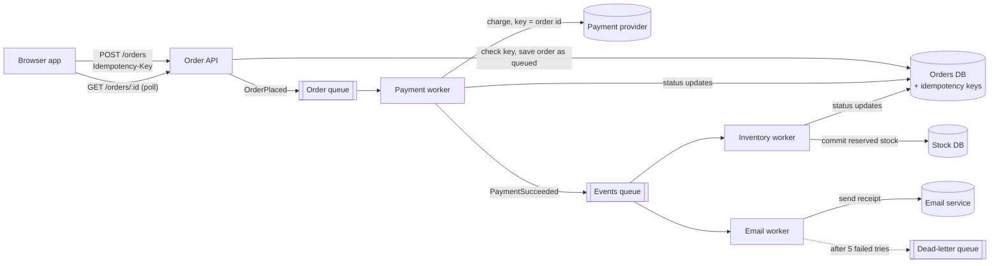

# Orders: a queue-based order service

This is a design for the backend behind `POST /api/orders`. The app doesn't include a real backend. The mock in `src/mocks/` imitates the visible part of this design: an order comes back as `queued`, moves to `processing` after 2 s and to `confirmed` after 5 s (`src/mocks/db.ts`), and the confirmation page polls `GET /api/orders/:id` until it sees a final status (`src/features/orders/orderQueries.ts`).

## The design

1. **Order API.** Checks the `Idempotency-Key`. If the key was seen before, it returns the order already stored for it. Otherwise it checks stock, reserves it (or answers 409 naming the item), saves the order as `queued`, puts an `OrderPlaced` message on the queue, and answers 201 at once. The user never waits for payment or email.
2. **Payment worker.** Takes `OrderPlaced`, charges the card and sets the order to `processing`, then `confirmed` or `failed`. On `failed` it releases the reserved stock.
3. **Inventory worker.** On `PaymentSucceeded`, turns the reservation into a real stock decrease and pushes the new number to the live stock feed (the WebSocket the app already listens to).
4. **Email worker.** On `PaymentSucceeded`, sends the receipt.

Each worker reads the queue independently, so each can be scaled, restarted or deployed on its own.

## Why a queue helps

- **Fast response.** The API only has to save the order and enqueue a message. Payment and email can take seconds; with a queue the user sees "Order received" immediately and the confirmation page shows progress.
- **Failures stay local.** If the email service is down, payment and inventory carry on. Without a queue, one slow or broken step would fail the whole checkout request.
- **Absorbs spikes.** During a sale, orders pile up in the queue instead of overloading the payment provider. More workers can be added to drain it faster (horizontal scaling).
- **Retries are built in.** A message isn't deleted until a worker finishes it. If a worker crashes halfway, the message is delivered again.

## What happens if email is down

1. The email worker fails to send and does not acknowledge the message, so it goes back on the queue.
2. It's retried with growing waits (for example 1 min, 5 min, 30 min), the same backoff idea the app uses to reconnect live stock.
3. After 5 failed tries, the message moves to a **dead-letter queue** and an alert fires. Someone fixes the cause and replays the messages from there.
4. Meanwhile **the order is still confirmed**: the customer was charged and the stock was taken. Only the receipt is late. The confirmation page and the account page still show the order, so the customer isn't left guessing.

Because messages can be delivered more than once, the email worker records "receipt sent for order X" and skips duplicates.

## How the idempotency key prevents a double charge

The risk: the user clicks **Place order**, the server creates the order, but the response is lost (bad Wi-Fi, a timeout). The user clicks again. Without protection that's a second order and a second charge.

What the app does today (D3-2):

- When checkout starts, `checkoutStarted` in `src/features/cart/cartSlice.ts` creates one key with `crypto.randomUUID()` and stores it in the cart. It is kept across retries and saved with the cart, so even a page reload reuses it.
- `createOrder` in `src/api/client.ts` sends it as the `Idempotency-Key` header on every attempt.
- The key is cleared only when the cart actually changes (a different order) or after success.
- The mock API stores orders by key (`ordersByIdempotencyKey` in `src/mocks/db.ts`) and returns the existing order for a repeated key. `checkout.test.tsx` checks that a retry after a lost response creates no second order.

How it carries through the queue design:

- **API:** the key is saved with the order in the same database transaction, with a unique constraint. Two simultaneous requests with the same key can't both create an order; the second gets the first order back.
- **Payment:** there is only ever one order, so only one `OrderPlaced` message. If that message is delivered twice, the payment worker sends the **order id** as the payment provider's own idempotency key, so the provider charges once and returns the same result the second time.

So a retry from the browser, a retried message in the queue, and a retried call to the payment provider all land on the same single charge.
